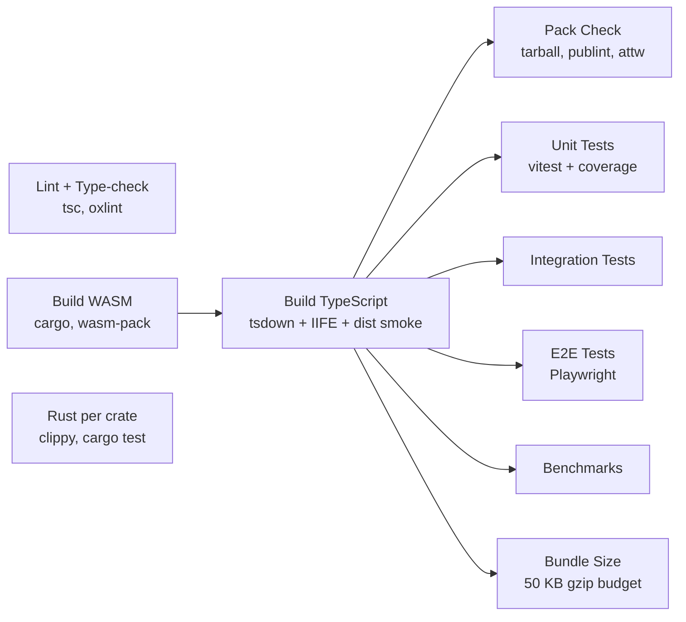

# Contributing to modern-pdf-lib

Thanks for your interest in contributing. This guide gets you from a clean clone
to a green pull request.

modern-pdf-lib is a **hybrid TypeScript + Rust/WASM** package: the engine is
TypeScript, and six Rust crates compile to WebAssembly and ship under
`dist/wasm/`. The library's JavaScript does not load those builds in this
release, so you can contribute to the TypeScript side without installing Rust.

---

## Quick Start

```bash
# Fork, then clone your fork
git clone https://github.com/<your-username>/modern-pdf-lib.git
cd modern-pdf-lib

# Install dependencies (frozen lockfile, the same install CI runs)
pnpm install --frozen-lockfile

# Run the test suite
pnpm test
```

> [!NOTE]
> The package manager is pnpm 12.19.0, pinned by `packageManager` in
> `package.json`. `pnpm-workspace.yaml` sets `minimumReleaseAge: 1440` (a
> version must be 24 hours old before it installs; exact exceptions are listed
> in `minimumReleaseAgeExclude`) and `strictDepBuilds: true` with `allowBuilds`
> for `esbuild` and `wasm-pack`, the only dependency build scripts that run.
> The project pins exact versions of pre-release tools, such as the TypeScript
> 7.1 dev build pinned in `package.json`.

### Prerequisites

| Tool | Version | Required for |
|---|---|---|
| Node.js | **>= 26.4** (`engines.node`); `devEngines` pins `28.0.0-nightly20261111e8c1160d20`, which pnpm can download | Everything |
| pnpm | **12.19.0** (`packageManager`) | Dependency install, all scripts |
| Rust + `wasm32-unknown-unknown` | `nightly-2026-11-11` (`rust-toolchain.toml`; rustup picks it up) | Only for `src/wasm/**` changes |
| `wasm-pack` | 0.15.1, a devDependency (no global install) | Only for `src/wasm/**` changes |
| Bash | Git Bash on Windows | `build:wasm` (shell script) |

> [!TIP]
> Skip Rust entirely unless you are touching `src/wasm/`. Tests, type-checking,
> linting, and the TypeScript build all run without a WASM toolchain.

---

## Development Workflow

1. **Branch from `master`** — use a descriptive name (`fix/png-embed-crash`,
   `feat/svg-support`).
2. **Make your change** — keep the PR focused on a single concern.
3. **Run the local gate** — the four commands below must all pass.
4. **Open a pull request** — fill out the template and link related issues.

### The local gate

Run these before pushing. They cover the Lint & Type-check, Build TypeScript and
Unit Tests jobs; CI also runs the WASM build, Pack Check, integration, E2E,
benchmark and bundle-size jobs, and the reporting-only Rust per-crate job.

```bash
pnpm run typecheck   # tsc over the root, cli, scripts and tests projects
pnpm run lint        # oxlint + tsgolint, type-aware, --max-warnings=1201
pnpm test            # vitest run — the full suite
pnpm run build       # tsdown + IIFE bundle + dist smoke test
```

### All scripts

<details>
<summary>Full script reference</summary>

Run each as `pnpm run <name>`.

| Script | What it does |
|---|---|
| `build` | `tsdown` bundle → `build-iife.ts` → `smoke-dist.mjs` |
| `build:wasm` | Build all six Rust crates with `wasm-pack` (release) |
| `build:iife` | Build the standalone `<script>` IIFE bundle |
| `build:all` | `build:wasm` → `build` → `copy:wasm` |
| `copy:wasm` | Copy each crate's `pkg/` output into `dist/wasm/<crate>/` |
| `check:pack` | Pack the tarball and check its file list, publint and attw |
| `smoke` | Import-check the built `dist/` as both ESM and CJS |
| `test` | Full Vitest run |
| `test:watch` | Vitest in watch mode |
| `test:integration` | Only `tests/integration` |
| `test:e2e` | Playwright browser E2E (`tests/e2e`) |
| `test:bench` | `vitest bench` over the benchmark files |
| `bench` | Benchmark suite via the tinybench harness |
| `lint` / `lint:fix` | oxlint, type-aware; `lint` fails above 1,201 warnings |
| `format` / `format:check` | oxfmt over `src`, `tests` and `scripts` |
| `typecheck` | `tsc` over the root, `tsconfig.cli.json`, `tsconfig.scripts.json` and `tsconfig.tests.json` projects |
| `dev` | Vite dev server |
| `docs:dev` / `docs:build` | VitePress site |
| `docs:api` | Regenerate the TypeDoc API reference + VitePress sanitizer |
| `generate:wasm-inline` | Regenerate `src/wasm/inlineWasm.generated.ts` |
| `validate-pdf` | Structural validation of a generated PDF |
| `clean` | Remove `dist/` and `coverage/` |

</details>

### Building the WASM crates

Only needed when you change Rust sources under `src/wasm/`.

```bash
# One-time toolchain setup
# (rustup reads rust-toolchain.toml; wasm-pack 0.15.1 comes from node_modules)
rustup target add wasm32-unknown-unknown

# Build all six crates (release)
pnpm run build:wasm

# Faster, unoptimised build while iterating
pnpm run build:wasm --debug
```

Output lands in `src/wasm/<crate>/pkg/` (git-ignored). `pnpm run copy:wasm` stages
those artifacts into `dist/wasm/<crate>/` for publishing. `scripts/build-wasm.sh`
takes its `wasm-opt` from a checksum-pinned binaryen (`version_133`, cached in
`.cache/binaryen`).

| Crate | Cargo package | Covers |
|---|---|---|
| `libdeflate` | `modern-pdf-deflate` | Stream compression (`FlateDecode`) |
| `png` | `modern-pdf-png` | PNG decoding for image embedding |
| `ttf` | `modern-pdf-ttf` | TrueType/OpenType metric, cmap and name parsing (subsetting stays in JS) |
| `shaping` | `modern-pdf-shaping` | Complex-script text shaping |
| `jbig2` | `modern-pdf-jbig2` | JBIG2 image decoding |
| `jpeg` | `modern-pdf-jpeg` | JPEG encode/decode |

---

## Code Style

Most of these are **enforced by tooling**, not just convention — the enforcing
rule is named so you know where it comes from.

| Rule | Enforced by |
|---|---|
| No `Buffer` — use `Uint8Array` for all binary data | oxlint `no-restricted-globals: ["Buffer"]` |
| No `any` casts | oxlint `typescript/no-explicit-any: error` |
| `const` by default, `let` only when reassigned | oxlint `prefer-const: error` |
| No unused variables (prefix intentional ones with `_`) | oxlint `no-unused-vars` |
| No stray `console` calls outside `src/cli/**` | oxlint `no-console: warn` (counts toward the lint warning budget) |
| TypeScript strict mode, `noUncheckedIndexedAccess`, `exactOptionalPropertyTypes` | `tsconfig.json` |
| **Explicit types on every export** (`isolatedDeclarations`) | `tsconfig.json` |
| ESM-only `import`/`export`, `verbatimModuleSyntax` | `tsconfig.json` |
| Single quotes, trailing commas, 100-col, LF endings | `.oxfmtrc.json` (`pnpm run format`; CI does not run `format:check`) |

> [!IMPORTANT]
> `isolatedDeclarations: true` is the rule newcomers hit first. Every exported
> function, class member, and constant needs an explicit return/value type
> annotation — TypeScript will not infer it across the declaration boundary.
> `pnpm run typecheck` catches this.

The `typescript/no-implied-eval` and `no-new-func` rules are off for the Acrobat
form-script evaluator, the streaming parser and `src/runtime/*.ts`, and
`no-console` is off for `src/cli/**` and the benchmark harness, via `overrides`
in `.oxlintrc.json`.
`typescript/no-non-null-assertion` is a warning that is off in `tests/**` and in
a listed set of hot-loop source files. Do not add new exemptions without
discussion in the PR.

---

## Testing

We use [Vitest](https://vitest.dev/) for unit, integration, and compliance
tests, and [Playwright](https://playwright.dev/) for browser E2E.

When adding a feature or fixing a bug: write a test that fails before your
change and passes after, then run the full suite.

| Directory | Contents | Count |
|---|---|---|
| `tests/unit/` | Per-module unit tests mirroring `src/` | 273 files |
| `tests/layout/` | Table, header/footer, and text-layout behaviour | 11 files |
| `tests/barcode/` | Symbology encoders (QR, Code 128, EAN, PDF417, …) | 10 files |
| `tests/image/` | Image decoders and embedding | 9 files |
| `tests/browser/` | Browser-surface APIs under a simulated DOM | 8 files |
| `tests/compliance/` | PDF/A, PDF/X, PDF/UA, e-invoicing conformance | 8 files |
| `tests/integration/` | Cross-module end-to-end document flows | 4 files |
| `tests/e2e/` | Playwright specs (`*.spec.ts`) driven through Vite | 1 spec |
| `tests/benchmarks/` | Benchmark suites (`pnpm run bench`, `pnpm run test:bench`) | — |
| `tests/fixtures/` | Shared sample PDFs and generated inputs | — |

Naming: `*.test.ts` for Vitest, `*.spec.ts` for Playwright. Place new tests in
the directory that matches the area under test, mirroring the `src/` layout.

---

## Continuous Integration

Every push and pull request against `master` runs [`.github/workflows/ci.yml`](.github/workflows/ci.yml).
All gating jobs must be green before a PR can merge; the Rust per-crate job and the Node 24 and `devEngines` unit-test legs report without failing the workflow.



`Lint + Type-check` and `Rust` run independently of the build chain — neither
waits on WASM, so style and type failures surface first.

| Job | Gate |
|---|---|
| Lint & Type-check | `pnpm run typecheck` (four projects) and `pnpm run lint` (type-aware oxlint, 0 errors, at most 1,201 warnings) |
| Build WASM | All six crates compile for `wasm32-unknown-unknown` |
| Build TypeScript | `pnpm run build` succeeds and `dist/` imports as ESM **and** CJS |
| Pack Check | `pnpm run check:pack`: the tarball lists six WASM builds and the IIFE bundle and passes publint and attw |
| Unit Tests | Full Vitest run with v8 coverage; Node 26 gates, the Node 24 and `devEngines` runtime legs are experimental and do not fail the workflow |
| Integration Tests | `tests/integration` green |
| E2E Tests | Playwright specs green in a real browser |
| Benchmarks | The benchmark harness runs without error |
| Bundle Size | `dist/index.mjs` stays at or under **50 KB gzipped** |
| Rust (per crate) | Clippy and `cargo test` per crate; reports only (`continue-on-error`) |

Releases run separately from [`.github/workflows/release.yml`](.github/workflows/release.yml)
on a version tag: it rebuilds WASM + TypeScript, packs and inspects the tarball,
**re-asserts that `ci.yml` succeeded on the same commit**, then publishes that
tarball to npm via OIDC trusted publishing (with
[provenance](https://docs.npmjs.com/generating-provenance-statements)). Push the
tag only for a commit that is already on `master` (`ci.yml` runs on pushes and
pull requests to `master`, and the release waits up to 60 minutes for that run),
and name it `v` plus the `package.json` version, which the build job checks. Docs
deploy independently from
[`.github/workflows/docs.yml`](.github/workflows/docs.yml) on every push to
`master`.

---

## Commit Messages

We follow [Conventional Commits](https://www.conventionalcommits.org/):

| Prefix | Use for |
|---|---|
| `feat:` | A new capability |
| `fix:` | A bug fix |
| `docs:` | Documentation only |
| `test:` | Tests only |
| `refactor:` | Behaviour-preserving restructuring |
| `perf:` | Performance work |
| `ci:` | Workflow and pipeline changes |
| `chore:` | Tooling, dependencies, housekeeping |

```
feat: add SVG embedding support
fix: correct CMYK color conversion in JPEG decoder
docs: update API reference for table layout
test: add edge case coverage for form evaluator
refactor: simplify encryption handler key derivation
```

Version numbers follow the project's own scheme — see [VERSIONING.md](./VERSIONING.md).

---

## Project Structure

| Module | Responsibility |
|---|---|
| `src/core/` | Document model, pages, object registry, writer, incremental save, merging |
| `src/parser/` | PDF parser, streaming parser, image decoders (CCITT, JBIG2, JPEG 2000) |
| `src/assets/` | Font, image, SVG, Markdown, and virtual-DOM embedding |
| `src/render/` | Content-stream interpreter, display list, rasterizer, Canvas adapter, OCR, diff |
| `src/annotation/` | Annotation objects, appearance generation, redaction application |
| `src/form/` | AcroForm fields, appearance streams, Acrobat JavaScript evaluator, JSON-Schema forms |
| `src/signature/` | PKCS#7/CAdES signing, cert path building, CRL/OCSP, LTV, timestamping |
| `src/crypto/` | RC4 and AES, key derivation, permission flags, MD5/SHA-256 |
| `src/security/` | Threat scanner, sanitizer, redaction verifier, encryption inspector |
| `src/compliance/` | PDF/A and PDF/X enforcement, associated files, Factur-X / ZUGFeRD e-invoicing |
| `src/accessibility/` | Structure tree, auto-tagging, marked content, PDF/UA validation |
| `src/layout/` | Tables, headers/footers, Knuth–Plass text layout, overflow, presets |
| `src/barcode/` | QR, Code 128, Code 39, EAN, ITF, PDF417, Data Matrix |
| `src/compression/` | Deflate: fflate adapter and the libdeflate WASM bridge |
| `src/color/` | Color-space conversion and ICC transforms |
| `src/metadata/` | XMP metadata, document info, viewer preferences |
| `src/outline/` | Bookmark / outline tree |
| `src/layers/` | Optional content groups (OCG layers) |
| `src/batch/` | Batch document processing |
| `src/plugins/` | Plugin system and built-in plugins |
| `src/runtime/` | Runtime detection, server adapters, capability probing, memory budget |
| `src/browser/` | Browser helpers: download, Web Worker, service worker |
| `src/jsx/` | JSX runtime and the `renderJsxToPdf` component renderer |
| `src/text/` | BiDi (UAX #9) text ordering |
| `src/cli/` | The `modern-pdf` CLI binary |
| `src/utils/` | Binary/encoding helpers, base64, validation, object pooling |
| `src/types/` | Shared type declarations (geometry, options, PDF primitives) |
| `src/wasm/` | Rust crates + the universal WASM loader and inline-bytes cache |

Supporting directories:

| Directory | Contents |
|---|---|
| `tests/` | The full test suite (see [Testing](#testing)) |
| `scripts/` | Build, codegen, fixture, and validation scripts |
| `tools/docs/` | Isolated TypeScript 6 sidecar for TypeDoc (a pnpm workspace member; no TS 7 path yet) |
| `docs/` | VitePress site source and guides; `docs/api/` is generated and git-ignored |
| `.github/` | CI, release, and docs workflows; issue and PR templates |

See the [README's project structure](./README.md#project-structure) for the
published module map.

---

## Documentation

The docs site is [VitePress](https://vitepress.dev/). Guides live in
`docs/guide/`, and `docs/api/` is **generated** by TypeDoc in CI (`docs.yml`) and
ignored by git — edit the TSDoc comments in `src/`, not the files under
`docs/api/`.

```bash
pnpm run docs:dev     # local dev server with hot reload
pnpm run docs:api     # regenerate the API reference from src/
pnpm run docs:build   # production build
```

> [!WARNING]
> `pnpm run docs:api` runs TypeDoc from `tools/docs`, a pnpm workspace package
> that the root `pnpm install` installs. TypeDoc has no TypeScript 7 path yet,
> so it runs against a pinned TypeScript 6 sidecar (`tools/docs/package.json`)
> rather than the root toolchain.

---

## Questions?

| Topic | Where |
|---|---|
| Bugs and feature requests | [GitHub Issues](https://github.com/ABCrimson/modern-pdf-lib/issues) |
| Security vulnerabilities | [SECURITY.md](./SECURITY.md) — **do not** open a public issue |
