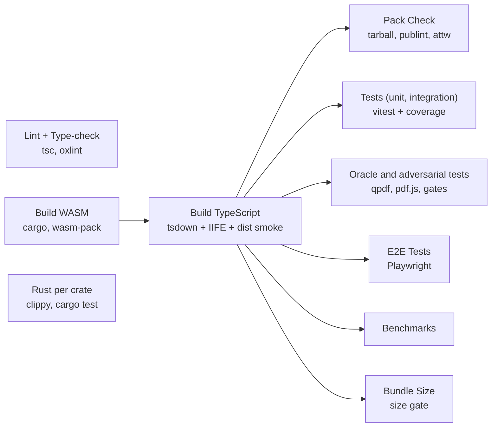

# Contributing to modern-pdf-lib

Thanks for your interest in contributing. This guide gets you from a clean clone
to a green pull request.

modern-pdf-lib is a **hybrid TypeScript + Rust/WASM** package: the engine is
TypeScript, and six Rust crates compile to WebAssembly and ship under
`dist/wasm/`. The library's JavaScript does not load those builds in this
release, so you can contribute to the TypeScript side without installing Rust.

---

## Quick Start

```bash
# Fork, then clone your fork
git clone https://github.com/<your-username>/modern-pdf-lib.git
cd modern-pdf-lib

# Install dependencies (frozen lockfile, the same install CI runs)
pnpm install --frozen-lockfile

# Run the test suite
pnpm test
```

> [!NOTE]
> The package manager is pnpm 12.21.0, pinned by `packageManager` in
> `package.json`. `pnpm-workspace.yaml` sets `minimumReleaseAge: 1440` (a
> version must be 24 hours old before it installs; exact exceptions are listed
> in `minimumReleaseAgeExclude`) and `strictDepBuilds: true` with `allowBuilds`
> for `esbuild` and `wasm-pack`, the only dependency build scripts that run.
> The project pins exact versions of pre-release tools, such as the TypeScript
> 7.1 dev build pinned in `package.json`.

### Prerequisites

| Tool | Version | Required for |
|---|---|---|
| Node.js | **>= 26.4** (`engines.node`); `devEngines` pins `28.0.0-nightly20261111e8c1160d20`, which pnpm can download | Everything |
| pnpm | **12.21.0** (`packageManager`) | Dependency install, all scripts |
| Rust + `wasm32-unknown-unknown` | `nightly-2026-11-15` (`rust-toolchain.toml`; rustup picks it up) | Only for `crates/**` changes |
| `wasm-pack` | 0.15.1, a devDependency (no global install) | Only for `crates/**` changes |
| Bash | Git Bash on Windows | `build:wasm` (shell script) |

> [!TIP]
> Skip Rust entirely unless you are touching `crates/`. Tests, type-checking,
> linting, and the TypeScript build all run without a WASM toolchain.

---

## Development Workflow

1. **Branch from `master`** — use a descriptive name (`fix/png-embed-crash`,
   `feat/svg-support`).
2. **Make your change** — keep the PR focused on a single concern.
3. **Run the local gate** — the four commands below must all pass.
4. **Open a pull request** — fill out the template and link related issues.

### The local gate

Run these before pushing. They cover the type-check and lint steps of the Lint &
Type-check job, the Build TypeScript job and the tests of the unit-test and
oracle jobs; CI also runs the WASM build, Pack Check, E2E, benchmark and
bundle-size jobs, the gates of the lint and oracle jobs, and the reporting-only
Rust per-crate job.

```bash
pnpm run typecheck   # tsc over the root, cli, scripts, tests and security-tests projects
pnpm run lint        # oxlint + tsgolint, type-aware, --max-warnings=1169
pnpm test            # vitest run: all four test projects
pnpm run build       # tsdown + IIFE bundle + dist smoke test
```

Install qpdf 12.4.2 and point `QPDF` at it (or put it on `PATH`) to run the
oracle tests locally; without it they skip with a reason (see
[Testing](#testing)). Run `pnpm run build` and `pnpm run copy:wasm` before
`pnpm test` for the API snapshot test, which skips without `dist/`.

### All scripts

<details>
<summary>Full script reference</summary>

Run each as `pnpm run <name>`.

| Script | What it does |
|---|---|
| `build` | `tsdown` bundle → `build-iife.ts` → `smoke-dist.mjs` |
| `build:wasm` | Build all six Rust crates with `wasm-pack` (release) |
| `build:iife` | Build the standalone `<script>` IIFE bundle |
| `build:all` | `build:wasm` → `build` → `copy:wasm` |
| `copy:wasm` | Copy each crate's `pkg/` output into `dist/wasm/<crate>/` |
| `check:pack` | Pack the tarball and check its file list, publint and attw |
| `smoke` | Import-check the built `dist/` as both ESM and CJS |
| `test` | Full Vitest run: all four projects |
| `test:watch` | Vitest in watch mode |
| `test:unit` | Only the `unit` project |
| `test:integration` | Only the `integration` project (`tests/integration`) |
| `test:oracle` | Only the `oracle` project (`tests/oracle`; needs qpdf, see [Testing](#testing)) |
| `test:adversarial` | Only the `adversarial` project (`tests/adversarial`) |
| `test:e2e` | Playwright browser E2E (`tests/e2e`) |
| `test:bench` | `vitest bench` over the benchmark files |
| `bench` | Benchmark suite via the tinybench harness |
| `lint` / `lint:fix` | oxlint, type-aware; `lint` fails above 1,169 warnings |
| `format` / `format:check` | oxfmt over `src`, `tests` and `scripts` |
| `typecheck` | `tsc` over the root, `src/cli/tsconfig.json`, `scripts/tsconfig.json`, `tests/tsconfig.json` and `tests/tsconfig.security.json` projects |
| `typecheck:security-tests` | `tsc` over `tests/tsconfig.security.json` only (the files it lists: the 0.40.5 security tests, the qpdf cross-check of encrypted saves, the known-defect helper tests, and `tests/helpers`) |
| `fixtures:legacy` | Rebuild `tests/fixtures/legacy-0.40.3/` from the published 0.40.3 tarball |
| `fixtures:legacy:check` | Check that those fixtures regenerate byte for byte |
| `node scripts/fixtures/legacy-0.26.0/generate.ts` (`--check` to verify; no package script) | Rebuild `tests/fixtures/legacy-0.26.0/` from the published 0.26.0 tarball, or check that it regenerates byte for byte |
| `fixtures:encrypted` | Write `tests/fixtures/encrypted/`: a source PDF and five copies encrypted by qpdf 12.4.2, and the `extra/` and `load/` sets the encrypted-load tests read |
| `fixtures:encrypted:check` | Regenerate them in a temp directory and fail on any difference (needs qpdf) |
| `fixtures:streams:check` | Check the raw data of every stream that the parser reads from `tests/fixtures` against the record `tests/fixtures/expected/stream-digests.json` (needs qpdf 12.4.2) |
| `check:test-projects` | Fail when a `tests/**/*.test.ts` file belongs to no Vitest project or to more than one |
| `check:known-defects` | Census of the known-defect markers; fails on a `fails` test without ledger ids, a malformed key or title, or a duplicate title |
| `corpus:check` | The corpus gate: manifest, sizes, licences and contact-data scan of `tests/fixtures/corpus/`, then the corpus tests (set `QPDF` for the qpdf checks) |
| `api:check` / `api:update` | Run the API snapshot test, `tests/oracle/packaging/exports.test.ts` (it needs `dist/`; `api:update` adds `-u` to rewrite the snapshot) |
| `gate:surface` | The findings ledger `audit/open-highs.json` against its schema, the markers against the ledger, and new exports against open findings |
| `gate:cap` | Match the capability rows of the README and the guides with `docs/capabilities.json` (report-only in this release) |
| `gate:size` | Bundle sizes of `dist/` (gzip and brotli) against `scripts/dev/size-budget.json`, and the README bundle badge; run after `build` |
| `conformance:generate` | Write the inputs of the nightly conformance workflow (runs under `tsx`; pass `--out <dir>`) |
| `conformance:verapdf` | Run an installed veraPDF (`VERAPDF` or `--verapdf`) over PDF files and print the conformance table |
| `dev` | Vite dev server |
| `docs:dev` / `docs:build` | VitePress site |
| `docs:api` | Regenerate the TypeDoc API reference + VitePress sanitizer |
| `generate:wasm-inline` | Regenerate `src/wasm/internal/inlineWasm.generated.ts` |
| `validate-pdf` | Structural validation of a generated PDF |
| `clean` | Remove `dist/` and `coverage/` |

</details>

### Building the WASM crates

Only needed when you change Rust sources under `crates/`.

```bash
# One-time toolchain setup
# (rustup reads rust-toolchain.toml; wasm-pack 0.15.1 comes from node_modules)
rustup target add wasm32-unknown-unknown

# Build all six crates (release)
pnpm run build:wasm

# Faster, unoptimised build while iterating
pnpm run build:wasm --debug
```

Output lands in `crates/<crate>/pkg/` (git-ignored). `pnpm run copy:wasm` stages
those artifacts into `dist/wasm/<crate>/` for publishing. `scripts/build/build-wasm.sh`
takes its `wasm-opt` from a checksum-pinned binaryen (`version_133`, cached in
`.cache/binaryen`).

| Crate | Cargo package | Covers |
|---|---|---|
| `libdeflate` | `modern-pdf-deflate` | Stream compression (`FlateDecode`) |
| `png` | `modern-pdf-png` | PNG decoding for image embedding |
| `ttf` | `modern-pdf-ttf` | TrueType/OpenType metric, cmap and name parsing (subsetting stays in JS) |
| `shaping` | `modern-pdf-shaping` | Complex-script text shaping |
| `jbig2` | `modern-pdf-jbig2` | JBIG2 image decoding |
| `jpeg` | `modern-pdf-jpeg` | JPEG encode/decode |

---

## Code Style

Most of these are **enforced by tooling**, not just convention — the enforcing
rule is named so you know where it comes from.

| Rule | Enforced by |
|---|---|
| No `Buffer` — use `Uint8Array` for all binary data | oxlint `no-restricted-globals: ["Buffer"]` |
| No `any` casts | oxlint `typescript/no-explicit-any: error` |
| `const` by default, `let` only when reassigned | oxlint `prefer-const: error` |
| No unused variables (prefix intentional ones with `_`) | oxlint `no-unused-vars` |
| No stray `console` calls outside `src/cli/**` | oxlint `no-console: warn` (counts toward the lint warning budget) |
| TypeScript strict mode, `noUncheckedIndexedAccess`, `exactOptionalPropertyTypes` | `tsconfig.json` |
| **Explicit types on every export** (`isolatedDeclarations`) | `tsconfig.json` |
| ESM-only `import`/`export`, `verbatimModuleSyntax` | `tsconfig.json` |
| Single quotes, trailing commas, 100-col, LF endings | `.oxfmtrc.json` (`pnpm run format`; CI does not run `format:check`) |

> [!IMPORTANT]
> `isolatedDeclarations: true` is the rule newcomers hit first. Every exported
> function, class member, and constant needs an explicit return/value type
> annotation — TypeScript will not infer it across the declaration boundary.
> `pnpm run typecheck` catches this.

The `typescript/no-implied-eval` and `no-new-func` rules are off for the
streaming parser, and
`no-console` is off for `src/cli/**` and the benchmark harness, via `overrides`
in `.oxlintrc.json`.
`typescript/no-non-null-assertion` is a warning that is off in `tests/**` and in
a listed set of hot-loop source files. Do not add new exemptions without
discussion in the PR.

---

## Testing

We use [Vitest](https://vitest.dev/) for unit, integration, oracle and
adversarial tests, and [Playwright](https://playwright.dev/) for browser E2E.

When adding a feature or fixing a bug: write a test that fails before your
change and passes after, then run the full suite.

### Test projects

`vitest.config.ts` defines four projects by include glob; `pnpm test` runs
all four, and `pnpm run test:<project>` runs one.

| Project | Files | What it holds | Retries |
|---|---|---|---|
| `unit` | `tests/unit` (339 files) | Module tests; it also owns the benchmark files | 2 |
| `integration` | `tests/integration` (3 files) | Cross-module document flows | 2 |
| `oracle` | `tests/oracle` (17 files) | The library's output judged by tools outside it (qpdf, pdf.js, an independent hash port), the real-world corpus, the API snapshot | 0 |
| `adversarial` | `tests/adversarial` (14 files) | Form-script escape probes, and inputs that must end in their error inside the budget of `tests/helpers/budget.ts` | 0 |

The unit and integration projects retry a failed test twice, so a rare
timing flake under full-suite load does not fail the run; a genuinely broken
test fails all three attempts. The oracle and adversarial projects never
retry: a failure there is a result. Every test file must match exactly one
project (`pnpm run check:test-projects`).

The adversarial project runs one file at a time (`fileParallelism: false`, so no
other file competes for the CPU) with retry 0. A file that checks a limit is a
pair: `tests/adversarial/<name>.test.ts` holds the assertions, and
`tests/adversarial/<name>.bodies.ts` holds the entries the runner loads, which
build their inputs in code. `runWithinBudget()` in `tests/helpers/budget.ts` runs
one entry on one input in a worker inside a child process, samples the child's
resident memory and reports `completed`, `threw` (error name, code and limit) or
`killed` (time, memory or crash). `DEFAULT_BUDGET` is 2000 ms and 512 MiB of
resident-memory growth: an input above a limit, and a malformed input, must end
in its error inside it (a page whose content streams pass the limit only together is held to `AT_LIMIT_BUDGET`). `AT_LIMIT_BUDGET` (5000 ms, 1536 MiB) is for an input at
or just under a limit, which is accepted and must complete; a regression in the
cost of a decode at a limit fails there. Both budgets are calibrated on a
developer machine. On a slower machine, set `MPL_BUDGET_TIME_SCALE` (a number of
at least 1; any other value fails at import) and the runner multiplies every
time budget by it; CI sets 4 for its hosted runners, which are several times
slower and vary from run to run. The memory budget is never scaled.

| Directory | Contents | Count |
|---|---|---|
| `tests/unit/` | Per-module unit tests mirroring `src/`; the scenario tests of one domain sit at the root of its mirror (the two rows below) | 339 files |
| `tests/unit/layout/` | Table, header/footer, and text-layout behaviour | 11 files |
| `tests/unit/browser/` | Browser-surface APIs under a simulated DOM | 8 files |
| `tests/integration/` | Cross-module end-to-end document flows | 3 files |
| `tests/oracle/` | Outside oracles: the writer matrix (qpdf and pdf.js on each writer path); AES and RC4 in both directions, with the PDF 2.0 password hash checked against qpdf-generated cases; `saveAsStream()` output; a 10,000-field document; the qpdf cross-check of encrypted saves; the read-old gates over the 0.40.3 and 0.26.0 fixtures; the comparison of decrypted objects with `qpdf --decrypt --qdf` object by object (`encrypted-qdf.test.ts`); the recovery of streams with a wrong, missing or late `/Length` (`stream-length.test.ts`); redaction leaks (pdf.js and a raw byte search); the corpus; the capability evidence; the zlib form of every `/FlateDecode` stream the writers and image encoders produce, judged by node:zlib, qpdf and pdf.js; the limits headroom over every corpus, legacy and fixture file; the byte-for-byte copy of JPX and JBIG2 streams on save, merge and copy, judged by qpdf; and `packaging/` (the API snapshot `exports.api.json` and its test) | 17 files |
| `tests/adversarial/` | Form-script escape probes against `FormScriptSandbox`; the `<name>.test.ts` and `<name>.bodies.ts` pairs that run decode, parse and render inputs under the budget runner | 14 files |
| `tests/helpers/` | `budget.ts`, `budget-child.ts` and `budget-worker.ts` (the budget runner: `runWithinBudget()`, `DEFAULT_BUDGET`, `AT_LIMIT_BUDGET`), `known-defect.ts` (the known-defect marker), `oracle/` (the qpdf and pdf.js wrappers, the setup file that fails an oracle test whose saved PDF did not go through qpdf, and the independent hash port) and the signature-trust fixtures (no tests of its own) | — |
| `tests/e2e/` | Playwright specs (`*.spec.ts`) driven through Vite | 1 spec |
| `tests/benchmarks/` | Benchmark suites (`pnpm run bench`, `pnpm run test:bench`) | — |
| `tests/fixtures/` | Shared sample PDFs and generated inputs; `legacy-0.40.3/` holds eight PDFs written by the published 0.40.3 and a `manifest.json` of their hashes (generator: `scripts/fixtures/legacy-0.40.3/generate.ts`; regenerate with `pnpm run fixtures:legacy`, never edit by hand); `legacy-0.26.0/` holds one AES-256 PDF written by the published 0.26.0 with its `manifest.json` (generator: `scripts/fixtures/legacy-0.26.0/generate.ts`, never edit by hand); `expected/stream-digests.json` records the stream data of every fixture (check it with `pnpm run fixtures:streams:check`) | — |
| `tests/fixtures/corpus/` | Unmodified PDF files written by other producers, with `manifest.json` (source, licence, SHA-256, contact-data result, admission values), `LICENSES/` and a README of its rules; add a file only with `node scripts/dev/corpus.ts --add` | 33 PDF files |
| `tests/fixtures/flate/` | Two PDFs written by qpdf 12.4.2 whose cross-reference streams, object streams and content streams hold zlib data, with a README of how they were made; `tests/unit/parser/flateRead.test.ts` loads them | 2 PDF files |
| `tests/fixtures/encrypted/` | A source PDF and five copies encrypted by qpdf 12.4.2, with `manifest.json` (`pnpm run fixtures:encrypted`); `extra/` holds two more AES-256 copies (revision 5, and revision 6 with a password that SASLprep changes), and `load/` holds the files the encrypted-load tests read: copies with object streams, an empty user password, crypt filter and signature-shaped variants (listed in `manifest.json`) | 25 PDF files |
| `tests/fixtures/pdf20-hash/` | `cases.json`: 512 PDF 2.0 password hash cases from 256 documents qpdf encrypted (`node scripts/fixtures/pdf20-hash-cases.ts`) | — |

Supporting directories of the test suite:

| Directory | Contents |
|---|---|
| `audit/` | `open-highs.json`, the public ledger of open audit findings (schema `open-highs.schema.json`, described in `audit/README.md`) |
| `scripts/build/` | The build steps: `build-iife.ts`, `smoke-dist.mjs`, `build-wasm.sh`, `copy-wasm.mjs`, `check-pack.mjs`, `generate-inline-wasm.ts`, and `sanitize-api-docs.ts` (the `docs:api` step) |
| `scripts/dev/` | The checks and gates: `test-projects.ts`, `known-defects.ts`, `corpus.ts`, `surface-gate.ts`, `capability-gate.ts`, `size-gate.ts` (budgets in `size-budget.json`) and `api-snapshot.ts`; and `validate-pdf.ts`, the structural validation of a generated PDF |
| `scripts/fixtures/` | The generators of `tests/fixtures/`: the qpdf fixture sets (`encrypted-fixtures.ts` and `pdf20-hash-cases.ts`), the fixtures written by published versions (`legacy-0.26.0/` and `legacy-0.40.3/`), `gen-fixtures.ts` and `gen-reference-pdf.ts`; and `stream-digests.ts`, which records and checks the stream data of every fixture |
| `scripts/conformance/` | The nightly conformance workflow: `generate.ts` (inputs), `summarize.ts` (tables and comparison), `hanko-report.py` (pyHanko reports) and `expected.json` (the expected results); `scripts/conformance/verapdf-validate.ts` runs veraPDF |

Naming: `*.test.ts` for Vitest, `*.spec.ts` for Playwright. Place new tests in
the directory that matches the area under test, mirroring the `src/` layout,
so that each file falls in exactly one project.

A test that shows a known open defect is a known-defect marker, never a plain
`test.fails`: `knownDefect(defectKey('<id>', '<until>'), title, { failsWith }, body)`
from `tests/helpers/known-defect.ts`, with the ledger id and the release that
fixes it written as literals. It counts as an expected failure only when the
body fails with an error that matches `failsWith`. Its id must be an open entry
of `audit/open-highs.json` whose target equals `until` (`pnpm run gate:surface`).
The fixing commit replaces the marker with a plain test.

The qpdf-backed tests (the oracle project, which `corpus:check` also runs for
the corpus, and the unit tests that compare with qpdf) use qpdf 12.x from
the `QPDF` environment variable, then `PATH`.
Locally, without qpdf, each such test skips with a reason, and `corpus:check`
also counts the encrypted corpus entries as unconfirmed; when `CI` is set, a
missing qpdf fails the test. The qpdf fixture generators under `scripts/fixtures/`
need qpdf 12.4.2 and refuse any other version. In CI the unit-test job and the
oracle job install the checksum-pinned qpdf and export `QPDF`. The API snapshot test needs
`dist/` and `dist/wasm/` (`pnpm run build`, `pnpm run copy:wasm`) and the
release tags: locally it skips without them, and in CI it fails.

With qpdf and a built `dist/`, `pnpm test` reports 373 files and 8,902
tests: 8,853 passed and 49 expected failures (the markers). Without qpdf,
8,484 pass, 11 are expected failures and 407 skip.

---

## Continuous Integration

Every push and pull request against `master` runs [`.github/workflows/ci.yml`](.github/workflows/ci.yml).
Merging does not wait for CI (master has no branch protection); `release.yml` publishes a tag only after `ci.yml` succeeded on that commit. The Rust per-crate job and the `devEngines` unit-test leg report without failing the workflow.



`Lint + Type-check` and `Rust` run independently of the build chain — neither
waits on WASM, so style and type failures surface first.

| Job | Gate |
|---|---|
| Lint & Type-check | `pnpm run typecheck` (five projects), `pnpm run lint` (type-aware oxlint, 0 errors, at most 1,169 warnings), `pnpm run check:test-projects` and `pnpm run check:known-defects` |
| Build WASM | All six crates compile for `wasm32-unknown-unknown` |
| Build TypeScript | `pnpm run build` succeeds and `dist/` imports as ESM **and** CJS |
| Pack Check | `pnpm run check:pack`: the tarball lists six WASM builds and the IIFE bundle and passes publint and attw |
| Tests (unit, integration) | The unit and integration projects with v8 coverage and the checksum-pinned qpdf; Node 26 gates, the `devEngines` runtime leg is experimental and does not fail the workflow |
| Oracle and adversarial tests | On the built `dist/` and a full clone: installs qpdf 12.4.2 (checked against the SHA-256 written in `ci.yml`, exported as `QPDF`), runs the adversarial and oracle projects, lists the markers of the oracle run (fails on a marker that did not fail for its stated reason), checks both qpdf fixture sets, and runs the corpus gate, the surface gate and the capability gate (report-only) |
| E2E Tests | Playwright specs green in a real browser |
| Benchmarks | The benchmark harness runs without error |
| Bundle Size | The size gate: the `createPdf`, `loadPdf`, root, per-entry and IIFE bundles stay within their gzip and brotli budgets in `scripts/dev/size-budget.json`, and the README badge states the `createPdf` figure |
| Rust (per crate) | Clippy and `cargo test` per crate; reports only (`continue-on-error`) |

The conformance workflow [`.github/workflows/conformance.yml`](.github/workflows/conformance.yml)
runs veraPDF and pyHanko over inputs written by the public writers, nightly, on
version tags and on demand. It never runs on pull requests and is report-only:
no verdict fails a job, and neither a merge nor a release waits for it.

Releases run separately from [`.github/workflows/release.yml`](.github/workflows/release.yml)
on a version tag: it rebuilds WASM + TypeScript, packs and inspects the tarball,
**re-asserts that `ci.yml` succeeded on the same commit**, then publishes that
tarball to npm via OIDC trusted publishing (with
[provenance](https://docs.npmjs.com/generating-provenance-statements)). Push the
tag only for a commit that is already on `master` (`ci.yml` runs on pushes and
pull requests to `master`, and the release waits up to 60 minutes for that run),
and name it `v` plus the `package.json` version, which the build job checks. Docs
deploy independently from
[`.github/workflows/docs.yml`](.github/workflows/docs.yml) on every push to
`master`.

---

## Commit Messages

We follow [Conventional Commits](https://www.conventionalcommits.org/):

| Prefix | Use for |
|---|---|
| `feat:` | A new capability |
| `fix:` | A bug fix |
| `docs:` | Documentation only |
| `test:` | Tests only |
| `refactor:` | Behaviour-preserving restructuring |
| `perf:` | Performance work |
| `ci:` | Workflow and pipeline changes |
| `chore:` | Tooling, dependencies, housekeeping |

```
feat: add SVG embedding support
fix: correct CMYK color conversion in JPEG decoder
docs: update API reference for table layout
test: add edge case coverage for form evaluator
refactor: simplify encryption handler key derivation
```

Version numbers follow the project's own scheme — see [VERSIONING.md](./VERSIONING.md).

---

## Project Structure

| Module | Responsibility |
|---|---|
| `src/core/` | Document model, pages, object registry, writer, incremental save, merging |
| `src/parser/` | PDF parser and streaming parser (the stream filters live in `src/codecs/`) |
| `src/assets/` | Font, image, SVG, Markdown, and virtual-DOM embedding |
| `src/render/` | Content-stream interpreter, display list, rasterizer, Canvas adapter, OCR, diff |
| `src/annotation/` | Annotation objects, appearance generation, `/Redact` annotations (applying them throws `RedactionIncompleteError`, code `redaction-incomplete`, in this release) |
| `src/form/` | AcroForm fields, appearance streams, an arithmetic evaluator for calculation scripts (not a JavaScript engine), `FormScriptSandbox` (its `execute()` throws `ScriptExecutionDisabledError`, code `script-execution-disabled`), JSON-Schema forms |
| `src/signature/` | PKCS#7/CAdES signing, cert path building, CRL/OCSP, LTV, timestamping |
| `src/crypto/` | RC4 and AES, key derivation, permission flags, MD5/SHA-256 |
| `src/security/` | Threat scanner, sanitizer, redaction verifier, encryption inspector |
| `src/compliance/` | PDF/A and PDF/X enforcement, associated files, Factur-X / ZUGFeRD e-invoicing |
| `src/accessibility/` | Structure tree, auto-tagging, marked content, PDF/UA validation |
| `src/layout/` | Tables, headers/footers, Knuth–Plass text layout, overflow, presets |
| `src/barcode/` | QR, Code 128, Code 39, EAN, ITF, PDF417, Data Matrix |
| `src/codecs/` | The stream filter pipeline (`streamDecode.ts`; JPEG 2000 and JBIG2 data throws `UnsupportedFilterError`), the JPEG 2000 and JBIG2 entry modules; under `internal/`, the CCITT decoder and Deflate: the `/FlateDecode` codec (`pdfFlate.ts`: zlib out; zlib, or raw DEFLATE as a fallback, in), the fflate adapter and the libdeflate WASM bridge |
| `src/color/` | Color-space conversion and ICC transforms |
| `src/graphics/` | Halftones, image and soft masks, mesh shadings, patterns, shading and PDF functions |
| `src/metadata/` | XMP metadata, document info, viewer preferences |
| `src/outline/` | Bookmark / outline tree |
| `src/layers/` | Optional content groups (OCG layers) |
| `src/batch/` | Batch document processing |
| `src/plugins/` | Plugin system and built-in plugins |
| `src/runtime/` | Server adapters, capability probing, memory budget |
| `src/browser/` | Browser helpers: download, Web Worker, service worker |
| `src/jsx/` | JSX runtime and the `renderJsxToPdf` component renderer |
| `src/text/` | BiDi (UAX #9) text ordering |
| `src/cli/` | The `modern-pdf` CLI binary |
| `src/utils/` | Base64, PDF value helpers, code frames |
| `src/internal/` | The resource limits (`limits.ts`) and the runtime warnings (`warnings.ts`) that every domain uses; no package entry exports them |
| `src/wasm/` | The universal WASM loader, the inline-bytes cache and the TypeScript side of the crates in `crates/` |

Supporting directories:

| Directory | Contents |
|---|---|
| `crates/` | The six Rust crates built to WebAssembly, one Cargo root each (see [Building the WASM crates](#building-the-wasm-crates)) |
| `tests/` | The full test suite (see [Testing](#testing)) |
| `audit/` | The public ledger of open audit findings (see [Testing](#testing)) |
| `scripts/` | Build, codegen, fixture, and validation scripts, one folder per purpose: `scripts/build/`, `scripts/dev/` (gates and checks), `scripts/fixtures/` (fixture generators) and `scripts/conformance/` |
| `tools/docs/` | Isolated TypeScript 6 sidecar for TypeDoc (a pnpm workspace member; no TS 7 path yet) |
| `docs/` | VitePress site source and guides; `docs/api/` is generated and git-ignored |
| `.github/` | CI, conformance, release, and docs workflows; the pins of the conformance tools (`conformance/`); issue and PR templates |

See the [README's project structure](./README.md#project-structure) for the
published module map.

---

## Documentation

The docs site is [VitePress](https://vitepress.dev/). Guides live in
`docs/guide/`, and `docs/api/` is **generated** by TypeDoc in CI (`docs.yml`) and
ignored by git — edit the TSDoc comments in `src/`, not the files under
`docs/api/`.

```bash
pnpm run docs:dev     # local dev server with hot reload
pnpm run docs:api     # regenerate the API reference from src/
pnpm run docs:build   # production build
```

> [!WARNING]
> `pnpm run docs:api` runs TypeDoc from `tools/docs`, a pnpm workspace package
> that the root `pnpm install` installs. TypeDoc has no TypeScript 7 path yet,
> so it runs against a pinned TypeScript 6 sidecar (`tools/docs/package.json`)
> rather than the root toolchain.

---

## Questions?

| Topic | Where |
|---|---|
| Bugs and feature requests | [GitHub Issues](https://github.com/ABCrimson/modern-pdf-lib/issues) |
| Security vulnerabilities | [SECURITY.md](./SECURITY.md) — **do not** open a public issue |
